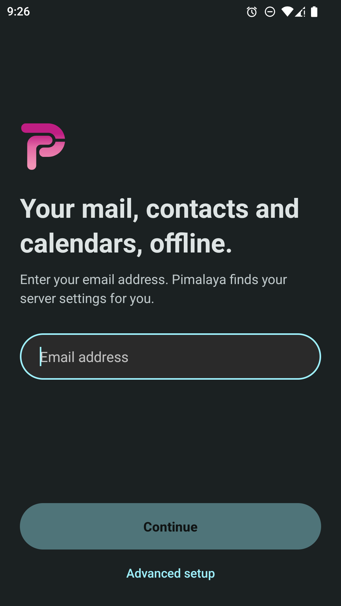
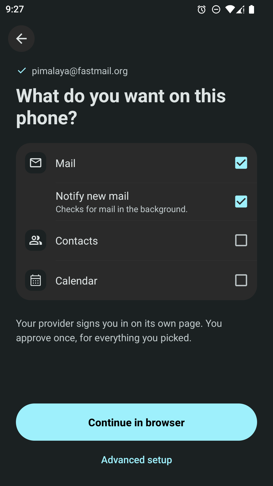
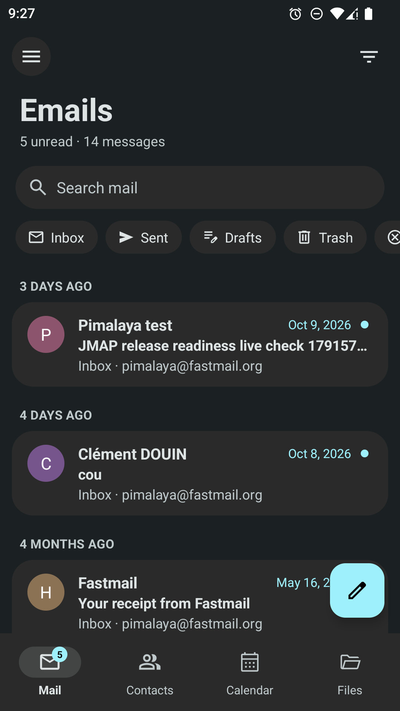
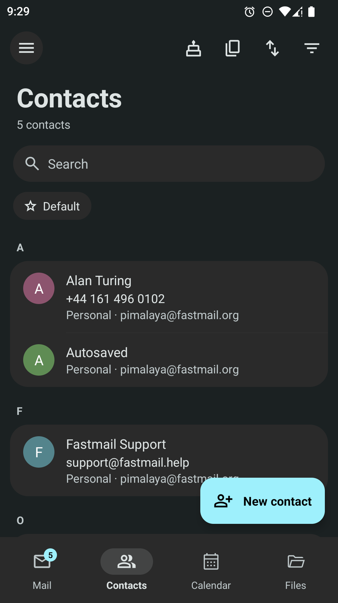
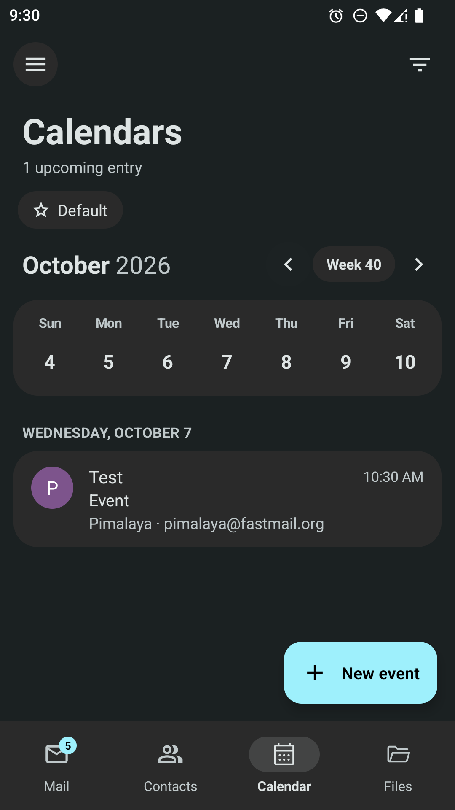
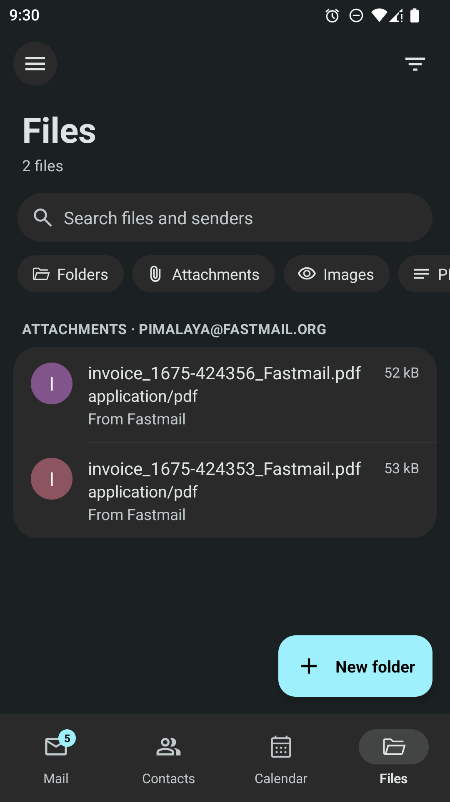
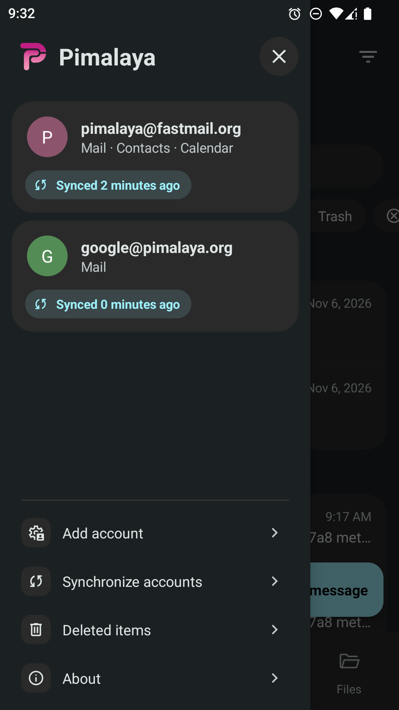
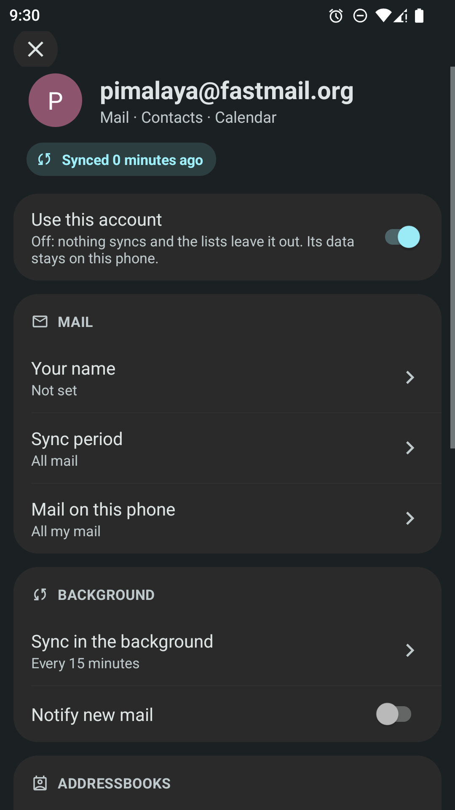

  
  <h1>🗂️ Pimalaya Android</h1>
  
Android app to manage your mail, contacts and calendars

  

    
    
    
  

> [!WARNING]
> Pimalaya for Android is in heavy testing: it works day to day, but expect rough edges, and what it stores on the phone may change between versions. To try it, either download the APK from the [latest release build](https://github.com/pimalaya/android/actions/workflows/releases.yml?query=branch%3Amaster+is%3Asuccess) on the CI (under *Artifacts*, a GitHub account is needed), or ask for Google Play early access at [pimalaya.org@posteo.net](mailto:pimalaya.org@posteo.net). Please report what goes wrong on the [issue tracker](https://github.com/pimalaya/android/issues).

<table>
<tr>
<td></td>
<td></td>
<td></td>
<td></td>
</tr>
<tr>
<td></td>
<td></td>
<td></td>
<td></td>
</tr>
</table>

## Table of contents

- [Features](#features)
- [Coverage](#coverage)
- [Installation](#installation)
  - [Google Play](#google-play)
  - [APK](#apk)
  - [Sources](#sources)
- [AI policy](https://github.com/pimalaya/.github/blob/master/AI_POLICY.md)
- [License](#license)
- [Social](#social)
- [Contributing](./CONTRIBUTING.md)
- [Sponsoring](#sponsoring)

## Features

- **All in one**: mail, contacts, calendars and your attachments in a single app.
- **Merged accounts**: one list per domain across every account, narrowed by filters and chips.
- **Automatic setup**: type your email address, the servers and the sign-in are found for you.
- **Offline first**: everything lives on the phone, and changes sync once the network is back.
- **Light syncs**: mail in steps of about 50, only the mailboxes you tick, only what changed.
- **Mail**: read, reply, forward, star and delete, and open or save attachments.
- **Contacts**: a complete vCard editor, duplicates merged, import and export.
- **Calendars**: create, edit and delete events, to-dos and journal entries.
- **Phone integration**: contacts and calendars in Android's own apps, new-mail notifications.
- **Private**: no account with us, no analytics, no ads; the app talks only to your providers.

## Coverage

| Provider | Mail | Contacts | Calendars |
|----------|------|----------|-----------|
| Gmail and Google Workspace | [Gmail API][gmail] | [People API][people] | [Calendar API][gcal] |
| Outlook.com and Microsoft 365 | [Microsoft Graph][msgraph] | [Microsoft Graph][msgraph] | [Microsoft Graph][msgraph] |
| Fastmail, and any JMAP server | [JMAP][rfc8621] | [JMAP][rfc9610] | [JMAP][jmapcal] |
| Posteo, and any standard provider | [IMAP][rfc3501] and [SMTP][rfc5321] | [CardDAV][rfc6352] | [CalDAV][rfc4791] |

Signing in works with a password, an app password, or [OAuth 2.0][rfc6749], including your provider's own when it supports [dynamic registration][rfc7591]. Servers are found from your address through [autoconfig][autoconfig], [PACC][pacc] and [DNS discovery][rfc6764].

[rfc3501]: https://www.rfc-editor.org/rfc/rfc3501
[rfc4791]: https://www.rfc-editor.org/rfc/rfc4791
[rfc5321]: https://www.rfc-editor.org/rfc/rfc5321
[rfc6352]: https://www.rfc-editor.org/rfc/rfc6352
[rfc6749]: https://www.rfc-editor.org/rfc/rfc6749
[rfc6764]: https://www.rfc-editor.org/rfc/rfc6764
[rfc7591]: https://www.rfc-editor.org/rfc/rfc7591
[rfc8621]: https://www.rfc-editor.org/rfc/rfc8621
[rfc9610]: https://www.rfc-editor.org/rfc/rfc9610
[jmapcal]: https://datatracker.ietf.org/doc/html/draft-ietf-jmap-calendars
[pacc]: https://datatracker.ietf.org/doc/html/draft-ietf-mailmaint-pacc
[autoconfig]: https://wiki.mozilla.org/Thunderbird:Autoconfiguration
[gmail]: https://developers.google.com/gmail/api
[people]: https://developers.google.com/people
[gcal]: https://developers.google.com/calendar
[msgraph]: https://learn.microsoft.com/en-us/graph/overview

## Installation

The app needs Android 8.0 or newer.

### Google Play

Google Play is in early access: ask for it at [pimalaya.org@posteo.net](mailto:pimalaya.org@posteo.net), then get updates automatically.

### APK

Download an APK from the [latest release build](https://github.com/pimalaya/android/actions/workflows/releases.yml?query=branch%3Amaster+is%3Asuccess), under *Artifacts* (a GitHub account is needed), and open it on your phone: pimalaya-arm64-v8a suits most phones, pimalaya all of them. The certificate's SHA-256 fingerprint is `2F:FD:69:7B:0A:C2:88:B6:A0:A2:24:AD:E9:73:53:B3:A2:77:E4:16:9A:37:50:BA:5C:55:75:43:3E:4A:FB:4D`.

### Sources

See the [contributing guide](./CONTRIBUTING.md).

## License

This project is licensed under either of:

- [MIT license](LICENSE-MIT)
- [Apache License, Version 2.0](LICENSE-APACHE)

## Social

- Chat on [Matrix](https://matrix.to/#/#pimalaya:matrix.org)
- News on [Mastodon](https://fosstodon.org/@pimalaya) or [RSS](https://fosstodon.org/@pimalaya.rss)
- Mail at [pimalaya.org@posteo.net](mailto:pimalaya.org@posteo.net)

## Sponsoring

Special thanks to the [NLnet foundation](https://nlnet.nl/) and the [European Commission](https://www.ngi.eu/) that have been financially supporting the project for years:

- 2022 → 2023: [NGI Assure](https://nlnet.nl/project/Himalaya/)
- 2023 → 2024: [NGI Zero Entrust](https://nlnet.nl/project/Pimalaya/)
- 2024 → 2026: [NGI Zero Core](https://nlnet.nl/project/Pimalaya-PIM/)
- 2026 → 2027: [NGI Zero Commons Fund](https://nlnet.nl/project/Pimalaya-pimdir/)

This program is part of Pimalaya, free software funded entirely by grants and donations. If you find it useful, consider [sponsoring](https://pimalaya.org/sponsor/) its development:

[![thanks.dev](https://img.shields.io/badge/-thanks.dev-000000?logo=data:image/svg+xml;base64,PHN2ZyB3aWR0aD0iMjQuMDk3IiBoZWlnaHQ9IjE3LjU5NyIgY2xhc3M9InctMzYgbWwtMiBsZzpteC0wIHByaW50Om14LTAgcHJpbnQ6aW52ZXJ0IiB4bWxucz0iaHR0cDovL3d3dy53My5vcmcvMjAwMC9zdmciPjxwYXRoIGQ9Ik05Ljc4MyAxNy41OTdINy4zOThjLTEuMTY4IDAtMi4wOTItLjI5Ny0yLjc3My0uODktLjY4LS41OTMtMS4wMi0xLjQ2Mi0xLjAyLTIuNjA2di0xLjM0NmMwLTEuMDE4LS4yMjctMS43NS0uNjc4LTIuMTk1LS40NTItLjQ0Ni0xLjIzMi0uNjY5LTIuMzQtLjY2OUgwVjcuNzA1aC41ODdjMS4xMDggMCAxLjg4OC0uMjIyIDIuMzQtLjY2OC40NTEtLjQ0Ni42NzctMS4xNzcuNjc3LTIuMTk1VjMuNDk2YzAtMS4xNDQuMzQtMi4wMTMgMS4wMjEtMi42MDZDNS4zMDUuMjk3IDYuMjMgMCA3LjM5OCAwaDIuMzg1djEuOTg3aC0uOTg1Yy0uMzYxIDAtLjY4OC4wMjctLjk4LjA4MmExLjcxOSAxLjcxOSAwIDAgMC0uNzM2LjMwN2MtLjIwNS4xNTYtLjM1OC4zODQtLjQ2LjY4Mi0uMTAzLjI5OC0uMTU0LjY4Mi0uMTU0IDEuMTUxVjUuMjNjMCAuODY3LS4yNDkgMS41ODYtLjc0NSAyLjE1NS0uNDk3LjU2OS0xLjE1OCAxLjAwNC0xLjk4MyAxLjMwNXYuMjE3Yy44MjUuMyAxLjQ4Ni43MzYgMS45ODMgMS4zMDUuNDk2LjU3Ljc0NSAxLjI4Ny43NDUgMi4xNTR2MS4wMjFjMCAuNDcuMDUxLjg1NC4xNTMgMS4xNTIuMTAzLjI5OC4yNTYuNTI1LjQ2MS42ODIuMTkzLjE1Ny40MzcuMjYuNzMyLjMxMi4yOTUuMDUuNjIzLjA3Ni45ODQuMDc2aC45ODVabTE0LjMxNC03LjcwNmgtLjU4OGMtMS4xMDggMC0xLjg4OC4yMjMtMi4zNC42NjktLjQ1LjQ0NS0uNjc3IDEuMTc3LS42NzcgMi4xOTVWMTQuMWMwIDEuMTQ0LS4zNCAyLjAxMy0xLjAyIDIuNjA2LS42OC41OTMtMS42MDUuODktMi43NzQuODloLTIuMzg0di0xLjk4OGguOTg0Yy4zNjIgMCAuNjg4LS4wMjcuOTgtLjA4LjI5Mi0uMDU1LjUzOC0uMTU3LjczNy0uMzA4LjIwNC0uMTU3LjM1OC0uMzg0LjQ2LS42ODIuMTAzLS4yOTguMTU0LS42ODIuMTU0LTEuMTUydi0xLjAyYzAtLjg2OC4yNDgtMS41ODYuNzQ1LTIuMTU1LjQ5Ny0uNTcgMS4xNTgtMS4wMDQgMS45ODMtMS4zMDV2LS4yMTdjLS44MjUtLjMwMS0xLjQ4Ni0uNzM2LTEuOTgzLTEuMzA1LS40OTctLjU3LS43NDUtMS4yODgtLjc0NS0yLjE1NXYtMS4wMmMwLS40Ny0uMDUxLS44NTQtLjE1NC0xLjE1Mi0uMTAyLS4yOTgtLjI1Ni0uNTI2LS40Ni0uNjgyYTEuNzE5IDEuNzE5IDAgMCAwLS43MzctLjMwNyA1LjM5NSA1LjM5NSAwIDAgMC0uOTgtLjA4MmgtLjk4NFYwaDIuMzg0YzEuMTY5IDAgMi4wOTMuMjk3IDIuNzc0Ljg5LjY4LjU5MyAxLjAyIDEuNDYyIDEuMDIgMi42MDZ2MS4zNDZjMCAxLjAxOC4yMjYgMS43NS42NzggMi4xOTUuNDUxLjQ0NiAxLjIzMS42NjggMi4zNC42NjhoLjU4N3oiIGZpbGw9IiNmZmYiLz48L3N2Zz4=)](https://thanks.dev/u/gh/soywod)

